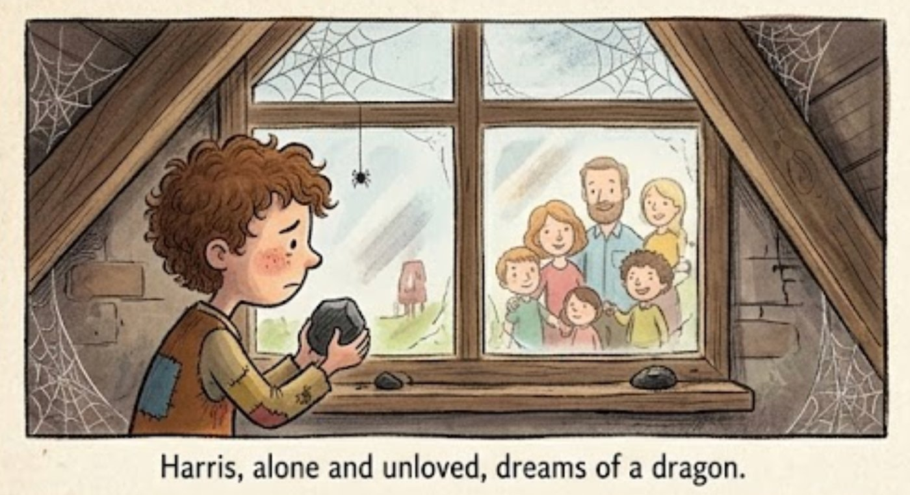
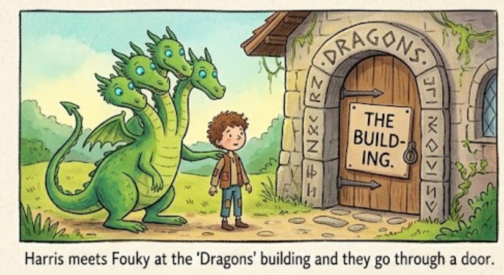
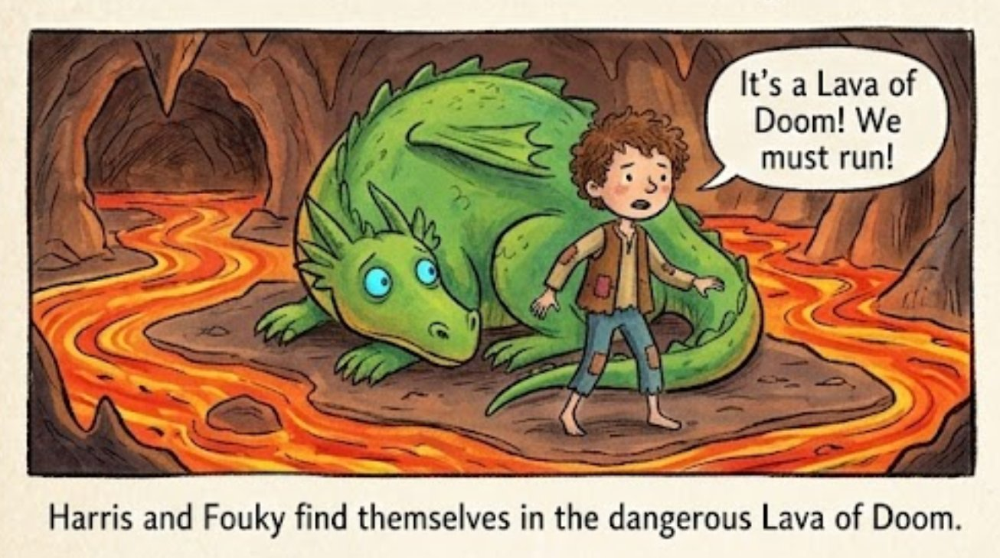
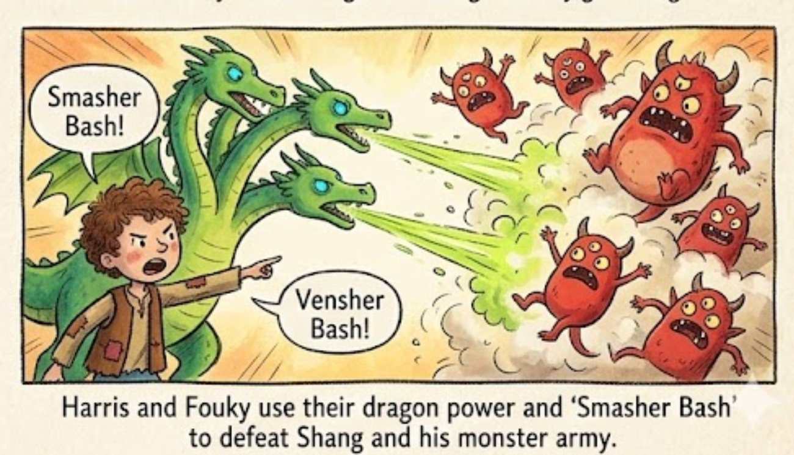

Mr and Mrs Ricky had a baby, but soon because of some kind of diseases they both died so the little baby wich was Harris Ricky got sent to Daniel's. When the family first saw him they acted kind to him, but later on they were only kind to Daniel. Daniel and Harris was the same age (2 years old). The family hated Harris so much when it was his birthday they'd give nothing but coal just a black coal. The family always sent Harris to his room but not a room with fun toys bright lights just a dark room with spider webs wich was at the attic. Harris often dreamed of getting a dragon there will at least 1 freind to play with "the dragon".

Years later Harris turned 7 he wanted to go to school like everyone else. He asked Mr and Mrs Daniel to send him to school but they would say "Too much money" "You know we hate you" but when Harris Ricky pleaded and pleaded finally it spelled Y-E-S. Today was the first day to go to school it was a ordinary school and he of course not as good as Daniel's school but he didnt mind.

Years passed slowly one day he was going to school when he saw a building he had never seen before it read "dragons". Harris thought for a moment he loved dragons but he was late for school finally he decided to go to the dragon building. A man greeted him cheerfully and said "Welcome to our building once you graduate your school you can never get out of here". Harris opened his mouth to ask the strange man when he dissapeared in a flash. Harris went to the building door forgetting the man he grabbed the door handle when something felt strange and in a flash he was gone.

Harris opened his eyes something was watering, no, not a rain it was dragon. yes a real live dragon! At first he couldn't belive his eyes. A dragon, was it possible? But then he remembered the strange man and the building that said dragon. The dragon had four heads and was green it had blue shining eyes Harris named him Fouky. A small door appeared on the rocky grounds. Harris opended the metal lid and they both went down.

THUMP! Harris landed on a rocky floor. "Where was he?" Suddenly WHOOSH! A Lava exploded with a boom. Fouky ran towards him and hid behind his leg, but of course he was too big. Harris realized this was no ordinary place it's a lava of doom! He and Fouky had to get out of here!

Harris and Fouky ran Harris’ legs ached and was bleeding sometimes he fell but he didn't give up. Then Harris saw a big cliff "That would be a good place to hide" Harris said he led Fouky to the big cliff but something was blocking them it had four eyes 2 horns and was red. "Get out of here this place is mine" and the strange monster called 7 big other horned monsters. It looked easy to fight but they were quite strong. Then a light lit up in his head "I have a dragon!" He exclaimed. And Fouky looked at Harris, Harris nodded. Crash! Boom! Mash! Smash! The 7 strong and harmful monsters were on the ground they werent breathing at all!

Yay! victory victory victory sweet! Then the strange monster which I would like to name it Shang interrupted the victory dance. "I am the ruler of the Lava cliff don't you dare to kill me!" Fouky looked at Harris. Harris looked at Fouky then they exploded with laughter. Time for a smash bash! They punched Shang. Fouky blasted venom. Finally the long fight was gone a servant from behind the shang's chair asked Harris "would you like to be the ruler of the lava cliff?” “nah! I prefer being me"
