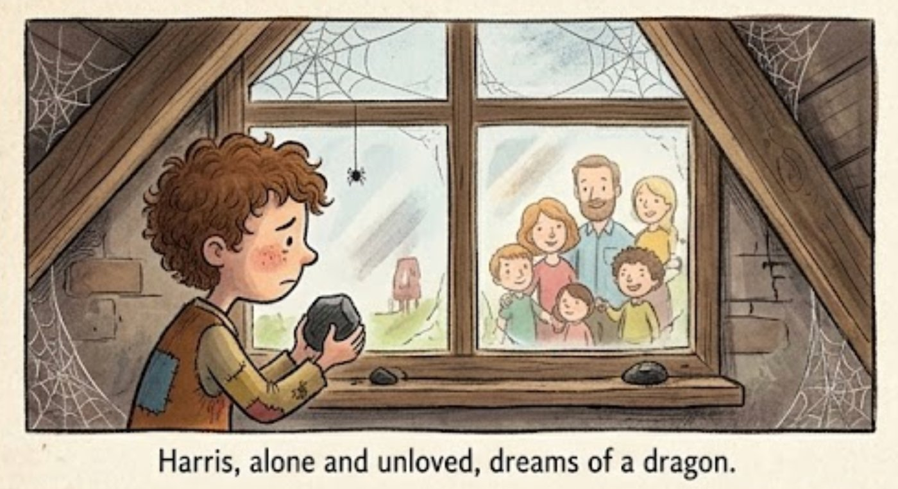
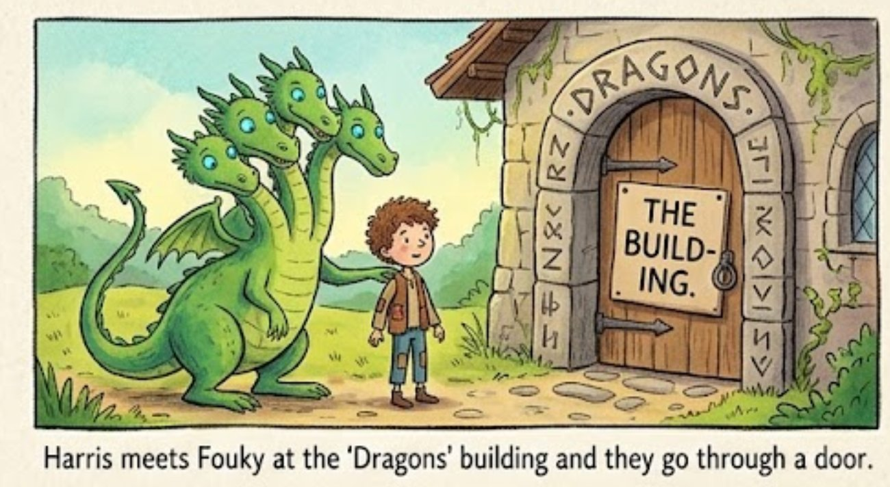
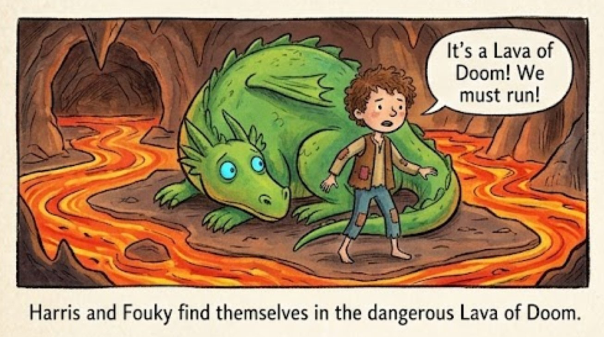
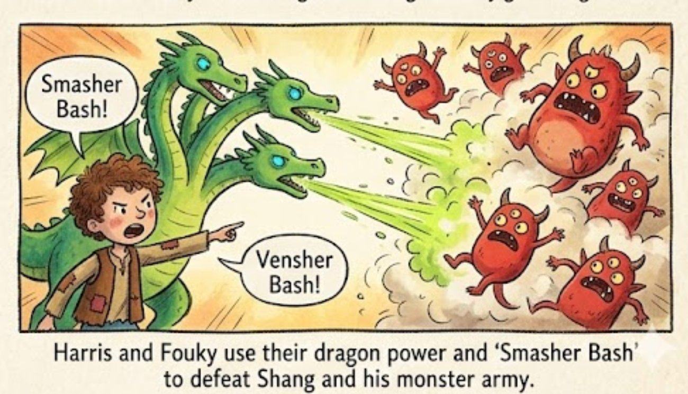

Mr and Mrs Ricky had a baby, but soon because of some kind of diseases they both died so the little baby which was Harris Ricky got sent to Daniel's. When the family first saw him they acted kind to him, but later on they were only kind to Daniel. Daniel and Harris was the same age (2 years old). The family hated Harris so much when it was his birthday they'd give nothing but coal just a black coal. The family always sent Harris to his room but not a room with fun toys bright lights just a dark room with spider webs which was at the attic. Harris often dreamed of getting a dragon there will at least 1 friend to play with "the dragon".

Years later Harris turned 7 he wanted to go to school like everyone else. He asked Mr and Mrs Daniel to send him to school but they would say "Too much money" "You know we hate you" but when Harris Ricky pleaded and pleaded finally it spelled Y-E-S. Today was the first day to go to school it was a ordinary school and he of course not as good as Daniel's school but he didn't mind.

Years passed slowly one day he was going to school when he saw a building he had never seen before it read "dragons". Harris thought for a moment he loved dragons but he was late for school finally he decided to go to the dragon building. A man greeted him cheerfully and said "Welcome to our building once you graduate your school you can never get out of here". Harris opened his mouth to ask the strange man when he disappeared in a flash. Harris went to the building door forgetting the man he grabbed the door handle when something felt strange and in a flash he was gone.

Harris opened his eyes something was watering, no, not a rain it was dragon. yes a real live dragon! At first he couldn't believe his eyes. A dragon, was it possible? But then he remembered the strange man and the building that said dragon. The dragon had four heads and was green it had blue shining eyes Harris named him Fouky. A small door appeared on the rocky grounds. Harris opened the metal lid and they both went down.

THUMP! Harris landed on a rocky floor. "Where was he?" Suddenly WHOOSH! A Lava exploded with a boom. Fouky ran towards him and hid behind his leg, but of course he was too big. Harris realized this was no ordinary place it's a lava of doom! He and Fouky had to get out of here!

Harris and Fouky ran Harris’ legs ached and was bleeding sometimes he fell but he didn't give up. Then Harris saw a big cliff "That would be a good place to hide" Harris said he led Fouky to the big cliff but something was blocking them it had four eyes 2 horns and was red. "Get out of here this place is mine" and the strange monster called 7 big other horned monsters. It looked easy to fight but they were quite strong. Then a light lit up in his head "I have a dragon!" He exclaimed. And Fouky looked at Harris, Harris nodded. Crash! Boom! Mash! Smash! The 7 strong and harmful monsters were on the ground they weren't breathing at all!

Yay! victory victory victory sweet! Then the strange monster which I would like to name it Shang interrupted the victory dance. "I am the ruler of the Lava cliff don't you dare to kill me!" Fouky looked at Harris. Harris looked at Fouky then they exploded with laughter. Time for a smash bash! They punched Shang. Fouky blasted venom. Finally the long fight was gone a servant from behind the Shang's chair asked Harris "would you like to be the ruler of the lava cliff?” “nah! I prefer being me"

<!--ko-->

리키 씨 부부에게 아기가 생겼지만 얼마 안 가 무슨 병 때문에 두 분 다 돌아가셔서 그 작은 아기, 그러니까 해리스 리키는 다니엘네 집으로 보내졌다. 그 가족은 처음 해리스를 봤을 때는 친절하게 굴었지만 나중에는 다니엘한테만 친절했다. 다니엘과 해리스는 나이가 같았다(2살). 그 가족은 해리스를 너무 싫어해서 생일이 되면 석탄밖에 안 줬다 그냥 까만 석탄 하나. 가족은 늘 해리스를 방으로 보냈는데 재미있는 장난감이랑 밝은 불빛이 있는 방이 아니라 다락에 있는 거미줄 쳐진 깜깜한 방이었다. 해리스는 자주 드래곤이 생기는 꿈을 꿨다 그러면 같이 놀 친구가 적어도 1명은 생기니까 "그 드래곤".

몇 년이 지나 해리스는 7살이 되었고 다른 애들처럼 학교에 가고 싶었다. 다니엘 씨 부부에게 학교에 보내 달라고 했지만 그분들은 "돈이 너무 많이 들어" "우리가 너 싫어하는 거 알잖아"라고 했다 하지만 해리스 리키가 조르고 또 조르자 마침내 답은 그-래 였다. 오늘은 학교에 가는 첫날이었다 평범한 학교였고 당연히 다니엘네 학교만큼 좋지는 않았지만 해리스는 상관없었다.

세월이 천천히 흘렀다 어느 날 학교에 가는데 한 번도 본 적 없는 건물이 보였다 "드래곤"이라고 쓰여 있었다. 해리스는 잠깐 생각했다 드래곤은 정말 좋아하지만 학교에 늦었는데 결국 드래곤 건물에 가기로 했다. 어떤 남자가 반갑게 맞으며 말했다 "우리 건물에 온 걸 환영한다 학교를 졸업하고 나면 넌 여기서 절대 못 나간단다". 해리스가 그 이상한 남자에게 물어보려고 입을 열었는데 남자는 번쩍 하고 사라졌다. 해리스는 남자를 잊어버리고 건물 문으로 갔다 문손잡이를 잡았는데 뭔가 느낌이 이상했고 번쩍 하더니 해리스도 사라졌다.

해리스가 눈을 떴다 뭔가 물이 떨어지고 있었다, 아니, 비가 아니라 드래곤이었다. 그렇다 진짜 살아 있는 드래곤! 처음에는 자기 눈을 믿을 수 없었다. 드래곤이라니, 이게 가능한가? 하지만 그 이상한 남자와 드래곤이라고 쓰여 있던 건물이 떠올랐다. 드래곤은 머리가 네 개였고 초록색이었고 파랗게 빛나는 눈을 가졌다 해리스는 이름을 포우키라고 지어 주었다. 바위투성이 땅에 작은 문이 나타났다. 해리스가 쇠 뚜껑을 열었고 둘은 아래로 내려갔다.

쿵! 해리스는 바위 바닥에 떨어졌다. "여기가 어디지?" 갑자기 쉬익! 용암이 쾅 하고 터졌다. 포우키가 해리스 쪽으로 달려와 다리 뒤에 숨었지만 당연히 너무 컸다. 해리스는 여기가 평범한 곳이 아니라는 걸 깨달았다 여기는 파멸의 용암이다! 해리스와 포우키는 여기서 나가야 했다!

해리스와 포우키는 달렸다 해리스의 다리는 아프고 피가 났고 가끔 넘어졌지만 포기하지 않았다. 그때 해리스는 커다란 절벽을 보았다 "저기가 숨기 좋겠다" 해리스가 말하고 포우키를 큰 절벽으로 데려갔는데 뭔가가 길을 막고 있었다 눈이 네 개 뿔이 2개에 빨간색이었다. "여기서 나가 여긴 내 자리다" 그러더니 그 이상한 괴물은 뿔 달린 큰 괴물 7마리를 더 불렀다. 싸우기 쉬워 보였지만 꽤 셌다. 그때 머릿속에 불이 켜졌다 "나한테는 드래곤이 있잖아!" 해리스가 외쳤다. 포우키가 해리스를 보았고, 해리스는 고개를 끄덕였다. 쾅! 쿵! 퍽! 와장창! 세고 해로운 괴물 7마리가 바닥에 쓰러졌고 숨을 하나도 안 쉬었다!

야호! 승리 승리 승리 달콤해! 그때 그 이상한 괴물이 나는 얘 이름을 샹이라고 짓고 싶은데 승리의 춤을 방해했다. "나는 용암 절벽의 지배자다 감히 나를 죽일 생각 마라!" 포우키가 해리스를 보았다. 해리스가 포우키를 보았고 둘은 웃음을 터뜨렸다. 스매시 배쉬 시간이다! 둘은 샹에게 주먹을 날렸다. 포우키는 독을 뿜었다. 드디어 긴 싸움이 끝났고 샹의 의자 뒤에 있던 하인이 해리스에게 물었다 "용암 절벽의 지배자가 되시겠습니까?" "아니! 난 그냥 나인 게 더 좋아"
