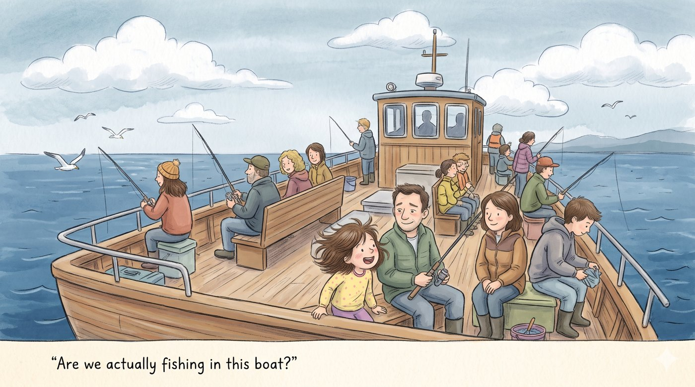
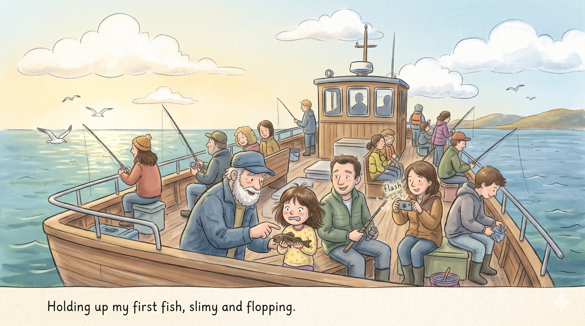

Have you ever went fishing in a small boat? Well, I did. "Are we actually fishing in this boat?" I asked excitedly as the cold breeze blew in front of me. My dad just smiled weakly. I think I heard him mutter, "Erin is surely excited for the first time fishing."

After, my dad was done baiting my hook for me, I finally started fishing. I threw the fishing line as far as I could. SPLASH! I sat on the chair next to me while I was waiting.

"Why aren't the fish biting?" I ask impatiently. "Just wait," the captain answered who was standing behind me. After a few minutes, which felt like an eternity, something rattled my fishing rod! "REEL!" The captain yelled! My dad and I reeled as fast as we could. A teeny tiny small brownish-black colored fish was dangling on the tip of the rod. "WHOA!" Shouted my dad excitedly.

"Hold the fish by the part next to the mouth." An old man, who I think is a professional fisherman, told me. I held the fish up. It felt slimy and it flopped a bit trying to escape. My mom took a picture of me several times. The sound of the repetitive flash was annoying to me.

I really hope I could go fishing again, like on this hot summer day I said inside my heart as I gazed at the sea.
