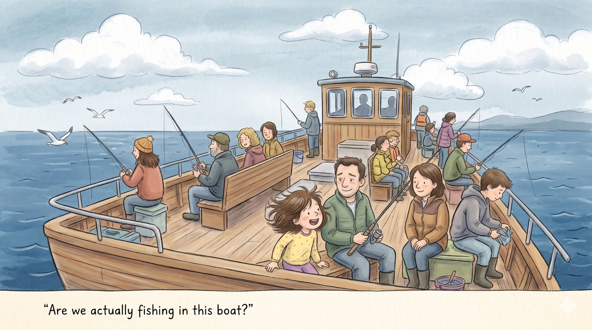
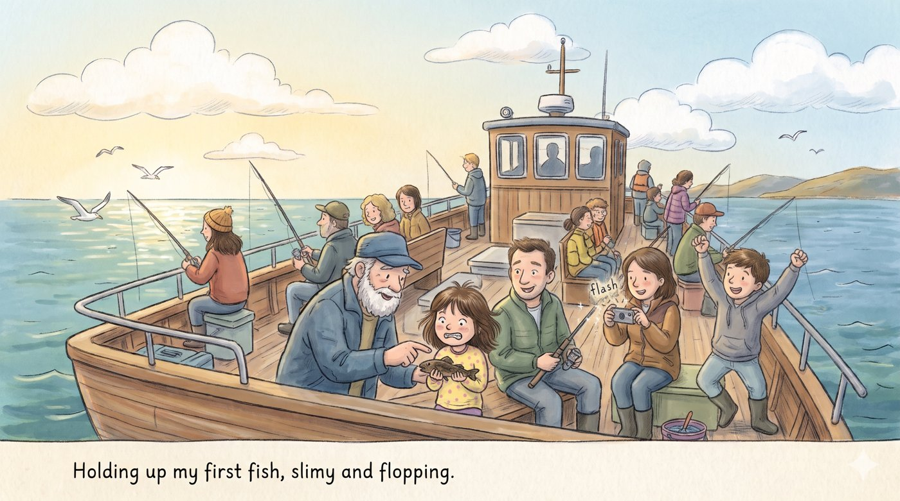

Have you ever went fishing in a small boat? Well, I did. "Are we actually fishing in this boat?" I asked excitedly as the cold breeze blew in front of me. My dad just smiled weakly. I think I heard him mutter, "Erin is surely excited for the first time fishing."

After, my dad was done baiting my hook for me, I finally started fishing. I threw the fishing line as far as I could. SPLASH! I sat on the chair next to me while I was waiting.

"Why aren't the fish biting?" I ask impatiently. "Just wait," the captain answered who was standing behind me. After a few minutes, which felt like an eternity, something rattled my fishing rod! "REEL!" The captain yelled! My dad and I reeled as fast as we could. A teeny tiny small brownish-black colored fish was dangling on the tip of the rod. "WHOA!" Shouted my dad excitedly.

"Hold the fish by the part next to the mouth." An old man, who I think is a professional fisherman, told me. I held the fish up. It felt slimy and it flopped a bit trying to escape. My mom took a picture of me several times. The sound of the repetitive flash was annoying to me.

I really hope I could go fishing again, like on this hot summer day I said inside my heart as I gazed at the sea.

<!--ko-->

작은 배에서 낚시해 본 적 있나요? 음, 나는 있어요. "우리 진짜 이 배에서 낚시하는 거예요?" 차가운 바람이 내 앞으로 불어오는데 나는 신이 나서 물었다. 아빠는 그냥 힘없이 웃었다. 아빠가 이렇게 중얼거리는 걸 들은 것 같다. "에린이 첫 낚시라고 아주 신이 났구나."

아빠가 내 낚싯바늘에 미끼를 다 끼워 준 다음, 나는 드디어 낚시를 시작했다. 낚싯줄을 있는 힘껏 멀리 던졌다. 첨벙! 기다리는 동안 나는 옆에 있는 의자에 앉았다.

"물고기가 왜 안 물어요?" 나는 조급하게 물었다. "그냥 기다려 봐." 내 뒤에 서 있던 선장님이 대답했다. 몇 분이 지나고, 그 몇 분이 영원처럼 느껴졌는데, 뭔가가 내 낚싯대를 덜덜 흔들었다! "감아!" 선장님이 소리쳤다! 아빠와 나는 최대한 빨리 릴을 감았다. 아주아주 조그맣고 갈색 섞인 검은색 물고기 한 마리가 낚싯대 끝에 매달려 있었다. "우와!" 아빠가 신나서 소리쳤다.

"물고기는 입 옆쪽을 잡아야 해." 내 생각에 프로 낚시꾼 같은 할아버지가 나에게 알려 주었다. 나는 물고기를 들어 올렸다. 미끌미끌했고 도망치려고 조금 파닥거렸다. 엄마가 내 사진을 여러 번 찍었다. 계속 터지는 플래시 소리가 나는 좀 거슬렸다.

이 더운 여름날처럼 또 낚시하러 갈 수 있으면 정말 좋겠다고 나는 바다를 바라보며 마음속으로 말했다.
