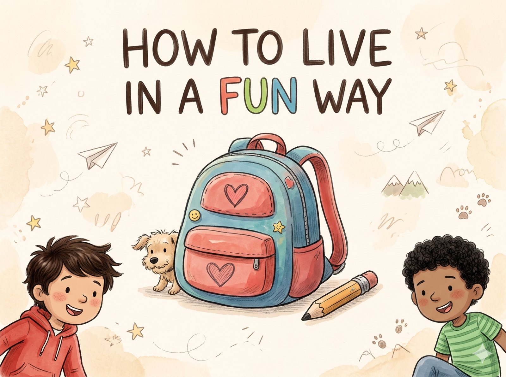
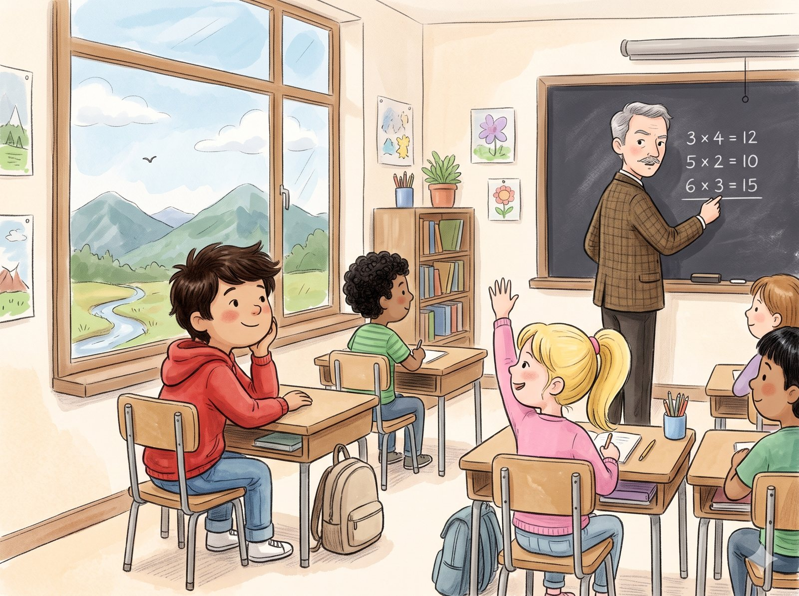
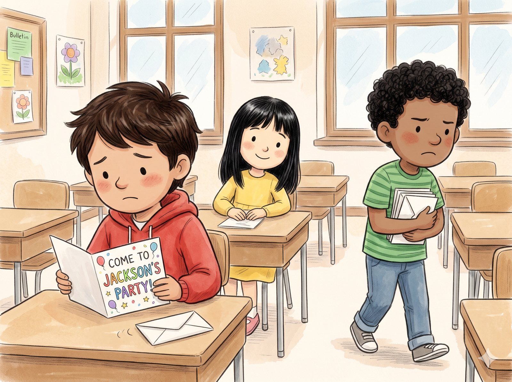
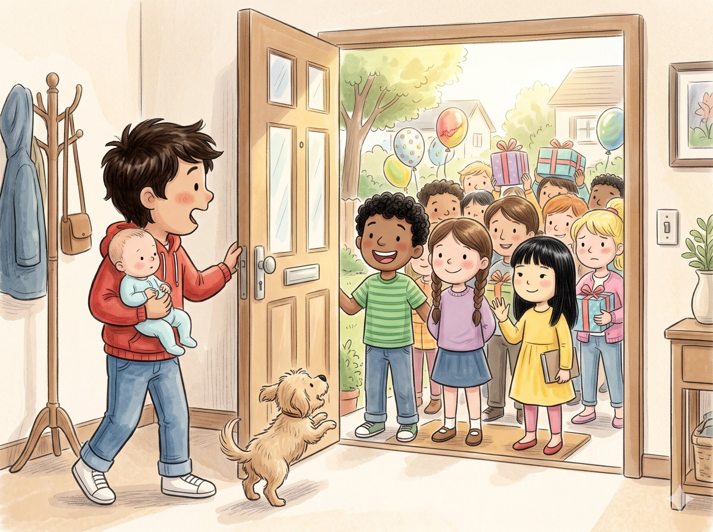

## Birthday

"SOOO?!" Asked Jackson as he hung his backpack down on the hook. "Sorry I can't go to your birthday party," I say very carefully just in case. "Oh come on!" Jackson says, "You're my very best friend." A stare at Jackson for a while and muttered. "My mom says I have to babysit my baby brother." Jackson opened his mouth to complain when the bell rang. Jackson glanced at me and then went to his desk.

Mr. Mason was teaching arithmetics. I couldn't concentrate. I gazed out the window and looked outside. The sky. The mountains. The bird. The stream. I gave me a question also. 'Should I just go to Jackson's birthday party leaving my brother Olly alone?' Suddenly, when I was about to give myself another question, Mr. Mason shouted, "Jose! What is the times table I just talked about?" I looked up at him. "Ya weren't listenin heh?" I hung my head and looked at the floor. I felt myself burn up as red as a tomato. Andrea suddenly shouted, "I know! I know! So I was listening! Right?" I glared at her. Because, Mr. Mason ignored her, I felt a bit better. "Gotta stay after school OK?" Mr. Mason said in this British accent. "Okay," I answered back in a teenytiny voice.

After lunch, Jackson passed his invitation out. He gave it gently, but he threw it at me. And I was the only one. I tore the envelope and got the card out. It read,

> COME TO JACKSON'S PARTY!  
> WHEN: 12 in the meantime SAT  
> WHERE: JACKSON'S HOUSE  
> MAKE SURE TO BRING PRESENTS!

Ellen.K smiled at me. The K stands for Kim, but people call her Ellen.K. "Are you going to Jackson's birthday party?" Ellen.K asked politely. I shook my head. "It's okay. You can go next time," Ellen.K smiled at me. I smiled back at her. "OH MY GOSH! Do you like Jose?" Andrea shouted. Everyone stared at us. Laughter exploded. Soon, everyone was chanting, "Jose and Ellen, sitting on a tree! K-I-S-S-I-N-G!" I felt my face burning up like a tomato. Ellen.K looked at the floor and murmured, "I am not marrying with him. Never." Then she ran to the bathroom, sobbing. Mr. Mason came back with Ellen.K to the classroom. Ellen.K's cheeks were red and had tears on her face. "Wow! She really must be a nerd!" Andrea whispered to the other girls she was friend with. "Okay class! I don't know who made Ellen.K cry and I won't mention the names. But I would want to write a letter to me, and say if you did it or not. Just be honest." Mr. Mason mentioned it very seriously. "Everyone remain silence while writing this letter," Mr. Mason passed out papers for everyone. Andrea suddenly broke the silence. "Mr. Mason, I never did something bad to Ellen.K, so I was very good. Right?" The other boys moaned. Why did Andrea have to be such a teacher's pet?

"Y-yes you were very—" Mr. Mason murmured when I interrupted him. "LIAR!" Mr. Mason looked at me and pointed at the calm corner. I walked slowly to the corner of the room. I sat in criss cross leg and leaned against the wall. I stared at the clock. tick-tock-tick-tock. Finally the bell rang! I jumped out of the corner and grabbed the backpack off the hook and ran to Jackson. Mr. Mason blocked way. "OH! Sorry Mr. Mason for running in the classroom!" I said impatiently. Mr. Mason shook his head. "Nope, that is not what I'm thinking about. Remember when I said to you to stay after school?" Mr. Mason said to me. A lightbulb popped into my head. "Oh yeah," I moaned. "What do we have to do?" I asked. "We just have to go through the multiplication table," Mr. Mason explained all about the tables. A whole hour passed and I was finally free. I ran all the way home. I opened the front door and my dog, Biscuit licked my face. "Mom! Can I go to Jackson's birthday party?" I ask with my smile that spreaded across my face. "When is it?" Mom asks. "This Saturday at 12." I answer back still with my smile. "Of course not! You have to babysit Olly. Remember?" My smile faded. I ask one more time with hope, "but we could have a babysiter."

"Jose, you know that Olly hates other people rather than your family! Last time Olly cried!" I became angry. I stomped to my bedroom upstairs. I slammed the bedroom door SLAM! I threw my backpack on my bed. I took the cell phone and dialed Jackson's house. R-R-I-I-N-G! "Hey Jackson! Can't go to your birthday party." I say loudly so that mom can hear it. "Oh man," Jackson replies. "Sorry, my mom is calling me." Jackson left the call. I sigh. "You okay?" Mom suddenly comes into my room. I tried not to hear her. Mom comes closer. I sat on my bed and looked away. Mom sat next to me. "You know Olly is half months old." I nod. "I know your feelings. But you and Jackson can make a plan." My ears perked. "What do you mean by that?" I asked curiously. "For example you can change the day he does the birthday party." Mom got up from the bed and left my room. 'Make a new plan,' I thought. Then I jumped up from my bed and ran to my table. I worked until night. When I finished it looked like this:

> Come TO Jackson's birthday party!  
> When: SAT 12 in the meantime  
> Where: Jose's house  
> MAKE SURE TO BRING PRESENTS!

I stepped back and looked at my work. The last task was to give it to my friends.

* * *

When I got to school, I quickly strode to the hall. The bell suddenly rang. 'OH-MAN!' I thought inside my head. "Okay class, today we will learn about different landmarks around the world," Mr. Mason announced loudly. Our class clown, Mark rose his hand. "Yes, Mark!" Mr. Mason called. Mark stood up and almost shouted, "OK. So there is a question. Will Andrea be a show-off today? Anyone who agrees raise your hand." Everyone except Andrea of course rose their hand. "Hey Andrea, why aren't you raising your hand? You know that you're going to be a real showoff today." Mark stood up from his chair and walked to Andrea's desk. He grabbed Andrea's hand and pulled it high up. "OK. So now everyone agrees even Andrea." The class giggled. "Okay, that's enough Mark." Mr. Mason said. He sure was looking angry. I quickly shouted without raising my hand. "Um, can I excuse myself to the bathroom? It's an emergency." Mark shouted, "Is it poop or pee?" Andrea snickered. "Yes you may" Mr. Mason answered back. I ran to the door just to look like it was an emergency. I put the invitation I made inside everyone's backpack. I ran to every single cubby. When I was done, I panted like I ran a million kilometers on a marathon. Then, I went back to my class.

* * *

The day had finally come. "Mom!" I shouted, "Can I go to Jackson's birthday party today?" Mom shook her head without even looking at me. I think she is too busy feeding Olly. I skipped all around the house this morning. Mom opened her mouth to say something. "OH! And I leave right now at 8:30 and I'll come back at night 7:20. It depends." Then, my mom left. Biscuit suddenly jumped on my lap. I laughed. Ring! The bell rang it was Lauren. The bell rang later. I opened the door. It was my whole class! Marie explained, "I knew it! I was also going to the bathroom at school and I saw you putting Jackson's invitation in our bags! So I explained it all to Jackson and the other guys." The kids nodded. "Anyways happy birthday" I shouted to Jackson. And he said that this was the best birthday ever!

## Glasses

"José! Why are you staring into the book?" Mom asked. "Nothing." I replied. Mom glanced at me and continued her work or whatever she was doing.

* * *

I was doodling on my book as usual. "José! You're the only one not paying attention! What is the answer of the problem I wrote down on the board?" I squeezed my eyes and peered. It was originally 9×3, but I looked it as 9×8. "Um... 72?" Mr. Mason frowned at me. He erased the board and wrote another question. "Then what about this?" Again, It was actually 10×2, but I looked it as 10×3. "30" I replied impatiently this time. "José something is wrong with you?" Mr. Mason said in his strong British accent.

* * *

I slammed the door open, and ran into my house. Biscuit bounded to me, but I ignored him. He whimpered and followed me. I went straight to the TV. Mom interrupted my fun. "José, Mr. Mason called me this evening and said that something is wrong with your eye. And I also noticed too. Let's go to the eye doctor." She pulled me all the way to the front porch cause I was ignoring her. 'I hate this' I thought inside my heart.

* * *

"Hmmm... I think this boy should wear glasses. Don't you think young fellow?" The Doctor looked at me. I gave my mom a I need you face. "I also think so" said mom ignoring me. So by then, I had to wear this dumb black round glasses.

* * *

In school, I tried to act normal wearing my glasses, but I couldn't help it with dudes asking me about my stupid-old glasses. Mr. Mason looked at me and said, "So ya did get ya glasses huh?" "Duh you see my glasses right on my face!" I pointed at my glasses. "OOOH! COOL!" Collin tried to cheer me up. Then it was Mary-yram who made me feel better. "Wanna come to my house?" She asked me. I nodded. Everybody liked that the Marie family's name could be the same on backwards. Like this. Mary Yram Hazel, Lucas Sacul Hazel, and Arin Nira Hazel. We decided to meet each other on Sunday. So readers, I'll let you guys imaginate the rest of the story, but wearing glasses isn't bad huh?

**THE END**
