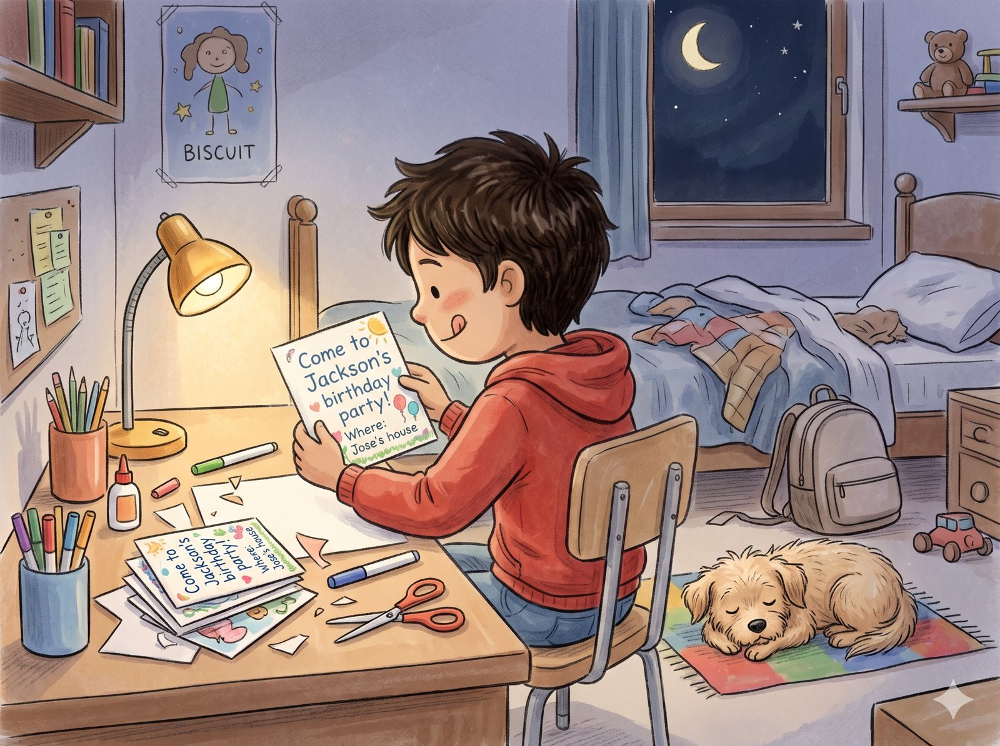
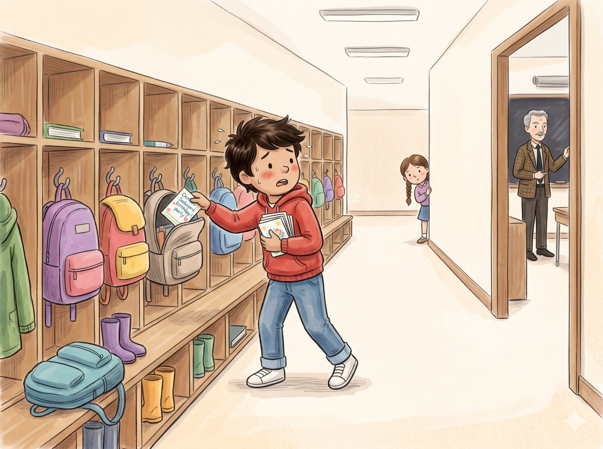
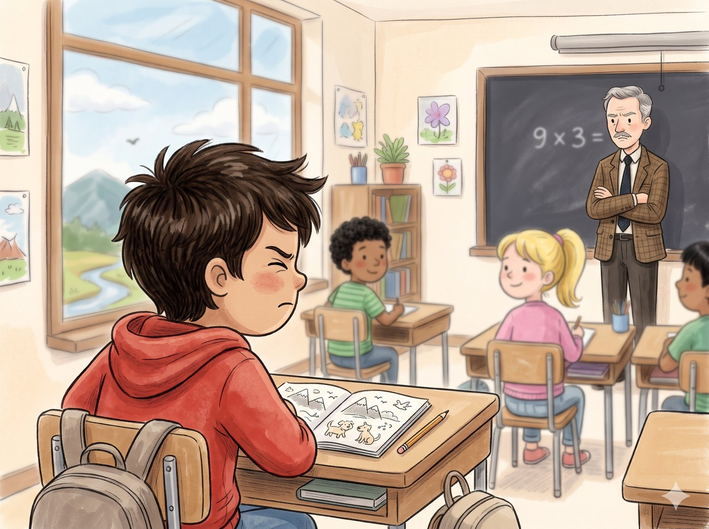
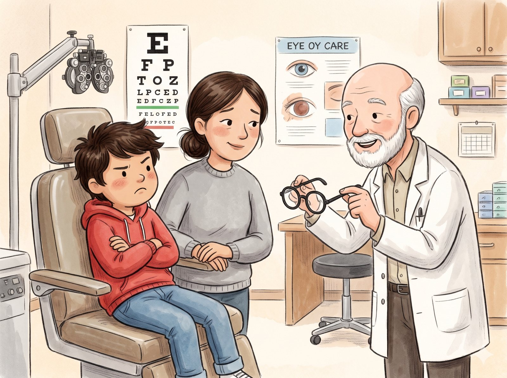
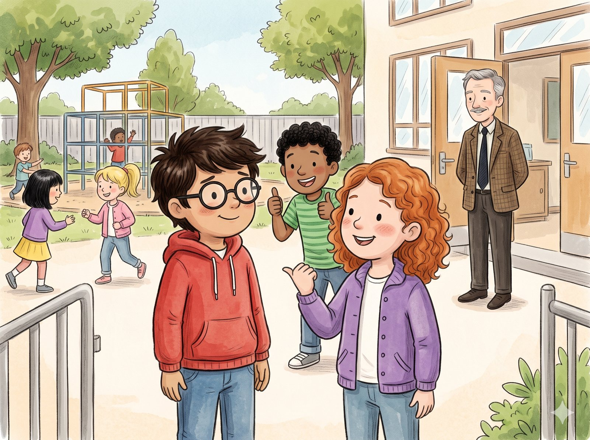

## Birthday

"SOOO?!" Asked Jackson as he hung his backpack down on the hook. "Sorry I can't go to your birthday party," I say very carefully just in case. "Oh come on!" Jackson says, "You're my very best friend." A stare at Jackson for a while and muttered. "My mom says I have to babysit my baby brother." Jackson opened his mouth to complain when the bell rang. Jackson glanced at me and then went to his desk.

Mr. Mason was teaching arithmetics. I couldn't concentrate. I gazed out the window and looked outside. The sky. The mountains. The bird. The stream. I gave me a question also. 'Should I just go to Jackson's birthday party leaving my brother Olly alone?' Suddenly, when I was about to give myself another question, Mr. Mason shouted, "Jose! What is the times table I just talked about?" I looked up at him. "Ya weren't listenin heh?" I hung my head and looked at the floor. I felt myself burn up as red as a tomato. Andrea suddenly shouted, "I know! I know! So I was listening! Right?" I glared at her. Because, Mr. Mason ignored her, I felt a bit better. "Gotta stay after school OK?" Mr. Mason said in this British accent. "Okay," I answered back in a teenytiny voice.

After lunch, Jackson passed his invitation out. He gave it gently, but he threw it at me. And I was the only one. I tore the envelope and got the card out. It read,

> COME TO JACKSON'S PARTY!  
> WHEN: 12 in the meantime SAT  
> WHERE: JACKSON'S HOUSE  
> MAKE SURE TO BRING PRESENTS!

Ellen.K smiled at me. The K stands for Kim, but people call her Ellen.K. "Are you going to Jackson's birthday party?" Ellen.K asked politely. I shook my head. "It's okay. You can go next time," Ellen.K smiled at me. I smiled back at her. "OH MY GOSH! Do you like Jose?" Andrea shouted. Everyone stared at us. Laughter exploded. Soon, everyone was chanting, "Jose and Ellen, sitting on a tree! K-I-S-S-I-N-G!" I felt my face burning up like a tomato. Ellen.K looked at the floor and murmured, "I am not marrying with him. Never." Then she ran to the bathroom, sobbing. Mr. Mason came back with Ellen.K to the classroom. Ellen.K's cheeks were red and had tears on her face. "Wow! She really must be a nerd!" Andrea whispered to the other girls she was friend with. "Okay class! I don't know who made Ellen.K cry and I won't mention the names. But I would want to write a letter to me, and say if you did it or not. Just be honest." Mr. Mason mentioned it very seriously. "Everyone remain silence while writing this letter," Mr. Mason passed out papers for everyone. Andrea suddenly broke the silence. "Mr. Mason, I never did something bad to Ellen.K, so I was very good. Right?" The other boys moaned. Why did Andrea have to be such a teacher's pet?

"Y-yes you were very—" Mr. Mason murmured when I interrupted him. "LIAR!" Mr. Mason looked at me and pointed at the calm corner. I walked slowly to the corner of the room. I sat in criss cross leg and leaned against the wall. I stared at the clock. tick-tock-tick-tock. Finally the bell rang! I jumped out of the corner and grabbed the backpack off the hook and ran to Jackson. Mr. Mason blocked way. "OH! Sorry Mr. Mason for running in the classroom!" I said impatiently. Mr. Mason shook his head. "Nope, that is not what I'm thinking about. Remember when I said to you to stay after school?" Mr. Mason said to me. A lightbulb popped into my head. "Oh yeah," I moaned. "What do we have to do?" I asked. "We just have to go through the multiplication table," Mr. Mason explained all about the tables. A whole hour passed and I was finally free. I ran all the way home. I opened the front door and my dog, Biscuit licked my face. "Mom! Can I go to Jackson's birthday party?" I ask with my smile that spreaded across my face. "When is it?" Mom asks. "This Saturday at 12." I answer back still with my smile. "Of course not! You have to babysit Olly. Remember?" My smile faded. I ask one more time with hope, "but we could have a babysiter."

"Jose, you know that Olly hates other people rather than your family! Last time Olly cried!" I became angry. I stomped to my bedroom upstairs. I slammed the bedroom door SLAM! I threw my backpack on my bed. I took the cell phone and dialed Jackson's house. R-R-I-I-N-G! "Hey Jackson! Can't go to your birthday party." I say loudly so that mom can hear it. "Oh man," Jackson replies. "Sorry, my mom is calling me." Jackson left the call. I sigh. "You okay?" Mom suddenly comes into my room. I tried not to hear her. Mom comes closer. I sat on my bed and looked away. Mom sat next to me. "You know Olly is half months old." I nod. "I know your feelings. But you and Jackson can make a plan." My ears perked. "What do you mean by that?" I asked curiously. "For example you can change the day he does the birthday party." Mom got up from the bed and left my room. 'Make a new plan,' I thought. Then I jumped up from my bed and ran to my table. I worked until night. When I finished it looked like this:

> Come TO Jackson's birthday party!  
> When: SAT 12 in the meantime  
> Where: Jose's house  
> MAKE SURE TO BRING PRESENTS!

I stepped back and looked at my work. The last task was to give it to my friends.

* * *

When I got to school, I quickly strode to the hall. The bell suddenly rang. 'OH-MAN!' I thought inside my head. "Okay class, today we will learn about different landmarks around the world," Mr. Mason announced loudly. Our class clown, Mark rose his hand. "Yes, Mark!" Mr. Mason called. Mark stood up and almost shouted, "OK. So there is a question. Will Andrea be a show-off today? Anyone who agrees raise your hand." Everyone except Andrea of course rose their hand. "Hey Andrea, why aren't you raising your hand? You know that you're going to be a real showoff today." Mark stood up from his chair and walked to Andrea's desk. He grabbed Andrea's hand and pulled it high up. "OK. So now everyone agrees even Andrea." The class giggled. "Okay, that's enough Mark." Mr. Mason said. He sure was looking angry. I quickly shouted without raising my hand. "Um, can I excuse myself to the bathroom? It's an emergency." Mark shouted, "Is it poop or pee?" Andrea snickered. "Yes you may" Mr. Mason answered back. I ran to the door just to look like it was an emergency. I put the invitation I made inside everyone's backpack. I ran to every single cubby. When I was done, I panted like I ran a million kilometers on a marathon. Then, I went back to my class.

* * *

The day had finally come. "Mom!" I shouted, "Can I go to Jackson's birthday party today?" Mom shook her head without even looking at me. I think she is too busy feeding Olly. I skipped all around the house this morning. Mom opened her mouth to say something. "OH! And I leave right now at 8:30 and I'll come back at night 7:20. It depends." Then, my mom left. Biscuit suddenly jumped on my lap. I laughed. Ring! The bell rang it was Lauren. The bell rang later. I opened the door. It was my whole class! Marie explained, "I knew it! I was also going to the bathroom at school and I saw you putting Jackson's invitation in our bags! So I explained it all to Jackson and the other guys." The kids nodded. "Anyways happy birthday" I shouted to Jackson. And he said that this was the best birthday ever!

## Glasses

"José! Why are you staring into the book?" Mom asked. "Nothing." I replied. Mom glanced at me and continued her work or whatever she was doing.

* * *

I was doodling on my book as usual. "José! You're the only one not paying attention! What is the answer of the problem I wrote down on the board?" I squeezed my eyes and peered. It was originally 9×3, but I looked it as 9×8. "Um... 72?" Mr. Mason frowned at me. He erased the board and wrote another question. "Then what about this?" Again, It was actually 10×2, but I looked it as 10×3. "30" I replied impatiently this time. "José something is wrong with you?" Mr. Mason said in his strong British accent.

* * *

I slammed the door open, and ran into my house. Biscuit bounded to me, but I ignored him. He whimpered and followed me. I went straight to the TV. Mom interrupted my fun. "José, Mr. Mason called me this evening and said that something is wrong with your eye. And I also noticed too. Let's go to the eye doctor." She pulled me all the way to the front porch cause I was ignoring her. 'I hate this' I thought inside my heart.

* * *

"Hmmm... I think this boy should wear glasses. Don't you think young fellow?" The Doctor looked at me. I gave my mom a I need you face. "I also think so" said mom ignoring me. So by then, I had to wear this dumb black round glasses.

* * *

In school, I tried to act normal wearing my glasses, but I couldn't help it with dudes asking me about my stupid-old glasses. Mr. Mason looked at me and said, "So ya did get ya glasses huh?" "Duh you see my glasses right on my face!" I pointed at my glasses. "OOOH! COOL!" Collin tried to cheer me up. Then it was Mary-yram who made me feel better. "Wanna come to my house?" She asked me. I nodded. Everybody liked that the Marie family's name could be the same on backwards. Like this. Mary Yram Hazel, Lucas Sacul Hazel, and Arin Nira Hazel. We decided to meet each other on Sunday. So readers, I'll let you guys imaginate the rest of the story, but wearing glasses isn't bad huh?

**THE END**

<!--ko-->

## 생일

"그래서어어?!" 잭슨이 가방을 고리에 걸면서 물었다. "미안, 네 생일 파티에 못 가." 나는 혹시 몰라서 아주 조심스럽게 말했다. "아, 왜!" 잭슨이 말했다. "넌 내 제일 친한 친구잖아." 나는 잭슨을 한참 바라보다가 중얼거렸다. "엄마가 아기 동생을 돌봐야 한대." 잭슨이 불평하려고 입을 여는 순간 종이 울렸다. 잭슨은 나를 힐끗 보고는 자기 자리로 갔다.

메이슨 선생님은 산수를 가르치고 계셨다. 나는 집중할 수가 없었다. 창밖을 멍하니 바라보았다. 하늘. 산. 새. 시냇물. 그리고 나 자신에게 질문도 하나 던졌다. '동생 올리를 혼자 두고 그냥 잭슨 생일 파티에 가 버릴까?' 또 다른 질문을 던지려던 바로 그때, 메이슨 선생님이 갑자기 소리치셨다. "호세! 내가 방금 말한 구구단이 뭐였지?" 나는 선생님을 올려다보았다. "안 듣고 있었구먼, 응?" 나는 고개를 푹 숙이고 바닥을 보았다. 얼굴이 토마토처럼 빨갛게 달아오르는 게 느껴졌다. 안드레아가 갑자기 소리쳤다. "저 알아요! 저 알아요! 그러니까 저는 듣고 있었던 거죠! 그쵸?" 나는 안드레아를 노려보았다. 메이슨 선생님이 안드레아를 못 들은 척하셔서 기분이 조금 나아졌다. "수업 끝나고 남아야 한다, 알겠지?" 메이슨 선생님이 그 영국식 말투로 말씀하셨다. "네." 나는 아주 조그만 목소리로 대답했다.

점심시간이 끝나고 잭슨이 초대장을 나눠 주었다. 다른 애들한테는 살살 건넸는데 나한테는 던졌다. 그런 건 나 하나뿐이었다. 나는 봉투를 찢고 카드를 꺼냈다. 이렇게 쓰여 있었다.

> 잭슨의 파티에 오세요!  
> 언제: 토요일 낮 12시  
> 어디서: 잭슨네 집  
> 선물 꼭 가져오기!

엘렌 K가 나를 보고 웃었다. K는 김(Kim)의 K인데, 다들 그냥 엘렌 K라고 부른다. "너 잭슨 생일 파티에 가?" 엘렌 K가 상냥하게 물었다. 나는 고개를 저었다. "괜찮아. 다음에 가면 되지." 엘렌 K가 웃어 주었다. 나도 마주 웃었다. "어머나 세상에! 너 호세 좋아해?" 안드레아가 소리쳤다. 모두가 우리를 쳐다보았다. 웃음이 터졌다. 금세 다들 노래를 부르기 시작했다. "호세랑 엘렌이 나무 위에 앉아서! 뽀-뽀-한-대-요!" 내 얼굴이 토마토처럼 달아올랐다. 엘렌 K는 바닥을 보며 중얼거렸다. "나 쟤랑 결혼 안 해. 절대로." 그러고는 흐느끼며 화장실로 달려갔다. 메이슨 선생님이 엘렌 K를 데리고 교실로 돌아오셨다. 엘렌 K의 뺨은 빨갰고 얼굴에는 눈물 자국이 있었다. "우와! 쟤 진짜 범생이인가 봐!" 안드레아가 같이 다니는 여자애들한테 속삭였다. "자, 여러분! 누가 엘렌 K를 울렸는지 선생님은 모르고, 이름을 말하지도 않을 거예요. 대신 선생님한테 편지를 써서 자기가 했는지 안 했는지 말해 주면 좋겠어요. 솔직하게만 쓰세요." 메이슨 선생님이 아주 진지하게 말씀하셨다. "편지 쓰는 동안은 모두 조용히 하세요." 선생님이 모두에게 종이를 나눠 주셨다. 안드레아가 갑자기 침묵을 깼다. "메이슨 선생님, 저는 엘렌 K한테 나쁜 짓 한 번도 안 했으니까 아주 착했던 거죠. 그쵸?" 남자애들이 끙 소리를 냈다. 안드레아는 왜 저렇게 선생님한테 잘 보이려고만 할까?

"그, 그래, 너는 아주…" 메이슨 선생님이 우물거리시는데 내가 끼어들었다. "거짓말쟁이!" 메이슨 선생님이 나를 보시더니 진정 코너를 가리키셨다. 나는 교실 구석으로 천천히 걸어갔다. 양반다리를 하고 앉아 벽에 기댔다. 시계를 뚫어져라 쳐다보았다. 똑-딱-똑-딱. 드디어 종이 울렸다! 나는 구석에서 튀어나와 고리에서 가방을 낚아채고 잭슨한테 달려갔다. 메이슨 선생님이 길을 막으셨다. "앗! 교실에서 뛰어서 죄송해요, 메이슨 선생님!" 나는 조급하게 말했다. 선생님은 고개를 저으셨다. "아니, 내가 생각하는 건 그게 아니다. 수업 끝나고 남으라고 한 거 기억나니?" 머릿속에 전구가 번쩍 켜졌다. "아, 맞다." 나는 끙 소리를 냈다. "뭘 해야 해요?" 내가 물었다. "구구단을 쭉 훑어보기만 하면 된다." 메이슨 선생님은 구구단을 전부 설명해 주셨다. 한 시간이 꼬박 지나고 나서야 나는 풀려났다. 집까지 내내 뛰었다. 현관문을 열자 우리 강아지 비스킷이 내 얼굴을 핥았다. "엄마! 저 잭슨 생일 파티 가도 돼요?" 나는 얼굴 가득 웃음을 띠고 물었다. "언젠데?" 엄마가 물었다. "이번 주 토요일 12시요." 나는 여전히 웃으며 대답했다. "당연히 안 되지! 올리 봐야 하잖아. 기억 안 나?" 웃음이 사라졌다. 나는 희망을 품고 한 번 더 물었다. "베이비시터를 부르면 되잖아요."

"호세, 올리가 가족 말고 다른 사람은 싫어하는 거 알잖니! 지난번에도 올리가 울었어!" 나는 화가 났다. 쿵쿵거리며 위층 내 방으로 올라갔다. 방문을 쾅! 닫았다. 가방을 침대에 던졌다. 휴대전화를 집어 잭슨네 집에 전화를 걸었다. 따르르릉! "야, 잭슨! 나 네 생일 파티 못 가." 엄마가 들으라고 큰 소리로 말했다. "아, 진짜." 잭슨이 대답했다. "미안, 엄마가 불러." 잭슨이 전화를 끊었다. 나는 한숨을 쉬었다. "괜찮니?" 엄마가 갑자기 내 방에 들어왔다. 나는 못 들은 척했다. 엄마가 더 가까이 왔다. 나는 침대에 앉아 고개를 돌렸다. 엄마가 내 옆에 앉았다. "올리는 아직 태어난 지 반 달밖에 안 됐잖니." 나는 고개를 끄덕였다. "네 마음 알아. 하지만 너랑 잭슨이 계획을 세워 볼 수 있잖아." 귀가 쫑긋 섰다. "그게 무슨 말이에요?" 나는 궁금해서 물었다. "예를 들면 생일 파티 하는 날을 바꿀 수도 있지." 엄마는 침대에서 일어나 방을 나갔다. '새 계획을 세우자.' 나는 생각했다. 그러고는 침대에서 벌떡 일어나 책상으로 달려갔다. 밤까지 작업했다. 다 만들고 보니 이런 모양이었다.

> 잭슨의 생일 파티에 오세요!  
> 언제: 토요일 낮 12시  
> 어디서: 호세네 집  
> 선물 꼭 가져오기!

나는 한 걸음 물러나 내 작품을 바라보았다. 마지막으로 남은 일은 이걸 친구들에게 나눠 주는 것이었다.

* * *

학교에 도착하자마자 나는 복도로 성큼성큼 걸어갔다. 갑자기 종이 울렸다. '아, 이런!' 속으로 생각했다. "자, 여러분, 오늘은 세계 여러 나라의 명소에 대해 배울 거예요." 메이슨 선생님이 큰 소리로 알리셨다. 우리 반 개그맨 마크가 손을 들었다. "그래, 마크!" 선생님이 부르셨다. 마크는 일어나서 거의 소리치듯 말했다. "좋아요. 질문이 하나 있습니다. 안드레아가 오늘도 잘난 척을 할까요? 그렇다고 생각하는 사람은 손을 드세요." 안드레아만 빼고 당연히 모두가 손을 들었다. "어이, 안드레아, 넌 왜 손 안 들어? 오늘도 네가 엄청 잘난 척할 거 너도 알잖아." 마크는 의자에서 일어나 안드레아 책상으로 걸어갔다. 안드레아의 손을 잡아서 높이 들어 올렸다. "좋아요. 이제 모두가 동의했네요. 안드레아까지도요." 반 아이들이 킥킥거렸다. "자, 그만하면 됐다, 마크." 메이슨 선생님이 말씀하셨다. 확실히 화가 나 보이셨다. 나는 손도 안 들고 얼른 소리쳤다. "저, 화장실 좀 다녀와도 돼요? 급해요." 마크가 소리쳤다. "큰 거야, 작은 거야?" 안드레아가 킬킬 웃었다. "그래, 다녀와라." 메이슨 선생님이 대답하셨다. 나는 진짜 급한 것처럼 보이려고 문까지 뛰어갔다. 내가 만든 초대장을 모든 아이의 가방 안에 넣었다. 사물함을 하나도 빠짐없이 돌았다. 다 끝냈을 때는 마라톤으로 백만 킬로미터를 뛴 것처럼 숨이 찼다. 그러고 나서 교실로 돌아갔다.

* * *

드디어 그날이 왔다. "엄마!" 내가 소리쳤다. "저 오늘 잭슨 생일 파티 가도 돼요?" 엄마는 나를 쳐다보지도 않고 고개를 저었다. 올리 밥 먹이느라 너무 바쁜 것 같다. 오늘 아침 나는 온 집 안을 깡충깡충 뛰어다녔다. 엄마가 뭔가 말하려고 입을 열었다. "아, 참! 엄마 지금 8시 30분에 나가서 밤 7시 20분에 돌아올 거야. 상황 봐서." 그리고 엄마는 나갔다. 비스킷이 갑자기 내 무릎 위로 뛰어올랐다. 나는 웃었다. 딩동! 초인종이 울렸다. 로렌이었다. 조금 있다가 초인종이 또 울렸다. 나는 문을 열었다. 우리 반 전체였다! 마리가 설명했다. "내 그럴 줄 알았어! 나도 학교에서 화장실 가다가 네가 우리 가방에 잭슨 초대장 넣는 걸 봤거든! 그래서 내가 잭슨이랑 다른 애들한테 전부 설명했어." 아이들이 고개를 끄덕였다. "어쨌든 생일 축하해!" 내가 잭슨에게 소리쳤다. 그리고 잭슨은 이번이 최고의 생일이라고 말했다!

## 안경

"호세! 왜 그렇게 책을 뚫어져라 보고 있니?" 엄마가 물었다. "아무것도 아니에요." 내가 대답했다. 엄마는 나를 힐끗 보고는 하던 일인지 뭔지를 계속했다.

* * *

나는 평소처럼 책에 낙서를 하고 있었다. "호세! 집중 안 하는 건 너 하나뿐이다! 내가 칠판에 적은 문제의 답이 뭐지?" 나는 눈을 가늘게 뜨고 들여다보았다. 원래는 9×3이었는데 내 눈에는 9×8로 보였다. "음… 72요?" 메이슨 선생님이 얼굴을 찌푸리셨다. 선생님은 칠판을 지우고 다른 문제를 적으셨다. "그럼 이건 어떠냐?" 이번에도 사실은 10×2였는데 내 눈에는 10×3으로 보였다. "30이요." 이번에는 조급하게 대답했다. "호세, 너 어디 안 좋은 거 아니냐?" 메이슨 선생님이 그 진한 영국식 말투로 말씀하셨다.

* * *

나는 문을 쾅 열고 집 안으로 뛰어 들어갔다. 비스킷이 나한테 껑충 달려왔지만 못 본 척했다. 비스킷은 낑낑거리며 나를 따라왔다. 나는 곧장 TV로 갔다. 엄마가 내 즐거움을 방해했다. "호세, 오늘 저녁에 메이슨 선생님이 전화하셨는데 네 눈에 문제가 있는 것 같다고 하시더라. 엄마도 그런 것 같았어. 안과에 가 보자." 내가 못 들은 척하니까 엄마는 나를 현관 앞까지 끌고 갔다. '진짜 싫다.' 나는 마음속으로 생각했다.

* * *

"흐음… 이 아이는 안경을 써야겠군요. 그렇게 생각하지 않니, 꼬마 친구?" 의사 선생님이 나를 보셨다. 나는 엄마한테 '도와주세요' 하는 표정을 지었다. "저도 그렇게 생각해요." 엄마는 나를 못 본 척하고 말했다. 그렇게 해서 나는 이 멍청한 까만 동그란 안경을 써야 했다.

* * *

학교에서 나는 안경을 쓰고도 아무렇지 않은 척하려고 했지만, 애들이 내 바보 같은 안경에 대해 자꾸 물어보는 건 어쩔 수가 없었다. 메이슨 선생님이 나를 보고 말씀하셨다. "그래, 안경을 맞췄구먼, 응?" "당연하죠, 제 얼굴에 떡하니 있는 거 보이시잖아요!" 나는 내 안경을 가리켰다. "오오! 멋지다!" 콜린이 기운을 북돋아 주려고 했다. 그런데 정말로 내 기분을 좋게 해 준 건 메리였다. "우리 집에 올래?" 메리가 나에게 물었다. 나는 고개를 끄덕였다. 다들 메리네 가족 이름이 거꾸로 읽어도 똑같다는 걸 좋아했다. 이런 식이다. 메리 이람 헤이즐(Mary Yram Hazel), 루카스 사쿨 헤이즐(Lucas Sacul Hazel), 그리고 아린 니라 헤이즐(Arin Nira Hazel). 우리는 일요일에 만나기로 했다. 그러니까 독자 여러분, 이야기의 나머지는 여러분이 상상하도록 맡길게요. 그래도 안경 쓰는 거, 나쁘지 않죠?

**끝**
